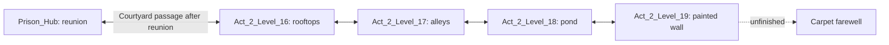

# Act 2 playtest readiness

Goal started 2026-10-07. Preserve finished Act 1 and the existing child artwork
and movement profile. Preserve the prison accessibility/checkpoint corrections
already in the working tree. User confirmed: castle and school-prison are one
fortified compound. The supplied author script now governs the story: the
four-key rescue leads into the chase, carpet farewell, return to the pond,
and completed poem; it is not the end of Act 2.

## Progress

- [x] Read AGENTS.md and STYLE_GUIDE.md; inventory both LDtk acts.
- [x] Record source hashes and pre-existing diff before this work.
- [x] Play and inspect representative Act 1 tutorial, exploration, mechanic
  development and late challenge rooms; derive the acceptance checklist.
- [x] Audit all Act 2 rooms, narrative connections, progression and presentation.
- [x] Milestone 1: connected castle approach and entrance, with gameplay captures.
- [x] Milestone 2: remaining levels and castle/school interior, with captures.
- [x] Milestone 3: end-to-end consistency, difficulty and presentation pass.
- [x] Build and smoke-test the distributable; deliver verification and limitations.

Current state: all three milestones are ready for the user's playtest. The
current continuous input solution completes all 39 rooms, earns four keys and
opens four locks, then reaches the authored final poem with zero deaths. All
35 lemons now have pickup/banking/room-transition evidence across the main run
and separate detours. The focused final regressions cover 29 passing checks,
plus import isolation. Act1-named files and the shared controller match baseline.

The macOS candidate is current and its checksum verifies. Native startup and
rendering passed; native packaged menu input remains unverified on the locked
Mac. Perceptual sound mix and difficulty/fun are for the user's playtest. These
and the two legacy broad-test limitations are documented in
`act2_verification.md`. The sections below retain historical findings and their
later corrections; old “remaining” lists are superseded by this handoff status.

## Initial findings — source inspection, not playtest conclusions

Act 1 contains 39 LDtk records, including test rooms. Act 2 contains 31:
three opening/legacy rooms, eleven garden courses, and seventeen prison rooms.
The castle art and three authoring layers exist but contain no painted cells.
The final garden currently enters the prison hub directly, without an approach
or threshold. The prison has tested key loops worth preserving. Its provisional
school art/scaffolding needs to be assessed beside the established Act 2 art.
The unusually large legacy `Level_2` and the two PlayerStart entities in
`Act_2_Level_0` need investigation before deciding on any geometry changes.

## Evidence rules

Keep separate: source inspection; automated assertions; input-driven scripted
solutions; observed gameplay directed from successive rendered frames; and
human playtest. A successful route establishes a solution, not enjoyment or
exhaustive accessibility. Test sessions bind no save slot. Native captures are
320×180; full-window captures additionally show dialogue and HUD.

Baseline: `output/act2_polish/baseline/tracked_sha256.json` and
`preexisting.patch`. Observed gameplay harness: `tests/act_polish_playtest.tscn`;
input commands contain actions and durations, never player positions/velocities.
It pauses between observations and saves state plus native and UI captures.
The initial room selection is a debug entry and must be identified as such;
ability acquisition must also be checked separately from a real act start.

## Author script integration

Source: `/Users/ari/Desktop/Hooshang - The Script.md`, supplied 2026-10-08.
The Act 2 text is preserved verbatim in `docs/story/act2_author_script.md`.
Act 1 text/runtime remain unchanged. Existing pond, campfire and dawn dialogue
now follows the supplied lines while retaining the established staging.

Remaining story milestones: wall graffiti and arrest; Palace of Corrections
entrance; four-key cell scene; playable friendly chase; carpet farewell;
adult Hooshang/Rumi at the pond; finishing the wall poem. Stage directions
belong in animation, sound, lighting and camera work, never spoken dialogue.
The cage now leads into the cell reunion; the outdoor chase and later
ending remain unfinished. No Act 3 story is authored in this source.
Scene skips must commit the same story/checkpoint endpoint as full playback.

Opening-dialogue verification: all 41 spoken lines match the supplied first
three scenes in order (source comparison). `act2_keyboard_skip_test` and
`act2_skip_staging_test` pass after updating their script markers. This proves
scene-skip behavior, not the unbuilt later story scenes.

Rendered opening playback reached all six capture stages (meeting, catch,
sunset, night, dawn, carpet) and returned control. Captures and regression
logs: `output/act2_polish/script_integration/`. This is automated scene
playback from a debug entry, not an end-to-end gameplay completion.

## Castle connection pass — 2026-10-08

Installed original LDtk rooms `Act_2_Level_14` (castle approach, 80×30 tiles)
and `Act_2_Level_15` (gatehouse, 60×30). Final garden exit now leads through
them to the prison hub. An Up-operated courtyard door returns from the hub.
Existing room geometry is preserved. Castle art uses the installed sheets.

Observed route: approach stairs → water recovery → gatehouse → prison hub →
courtyard door → gatehouse → approach, with real child inputs and zero deaths.
The complete replay inputs, native capture and session log are under
`output/act2_polish/milestone1/castle_roundtrip/` and `roundtrip_inputs.json`.
This starts at a debug approach entry; the full garden-to-castle route is still
pending. The scenery and wall/arrest scenes are unfinished, so milestone 1
is not yet complete.

Found and fixed two gameplay defects: nested scenery tile layers inherited
solid collision from their atlas; backward courtyard arrival incorrectly
pointed the gatehouse's left edge back into the prison.

Automated checks passed: castle tileset (including nested scenery), castle
connections (actual exit/Up interaction, safe death retry, backward route),
prison portals/source sync, movement smoke, world bounds, backtrack clearance,
forward entry, child tempo, movement isolation. Transition tests use deliberate
test positioning and are distinct from the observed input-only roundtrip.
A first connection assertion expected an airborne return marker to equal its
settled floor position; it now checks stable supported ground, unchanged
checkpoint, correct horizontal landing, and exactly one death.
359 Act 1-named tracked sources/assets still match their baseline hashes.

## Wall and palace scenes — 2026-10-08

- [x] Compile all nine supplied Act 2 script sections into a portable dialogue
  resource, preserving spoken text and keeping stage directions out of dialogue.
- [x] Place wall/arrest and palace-introduction encounters in LDtk. The 27 wall
  lines and 2 palace lines play in order; completion persists through save/load.
- [x] Add the principal, whistle/can impact, unfinished Persian inscription,
  graffiti poster and gate rules/quest banner. Temporary scene camera bounds
  keep the actors clear of the dialogue and restore on playback or skip.
- [x] Observe real-input entry → wall skip → stairs/water → palace skip →
  gatehouse, zero deaths. Captures: `milestone1/story_observed/`.
- [x] Render full 29-line playback from debug positioning and inspect native
  and UI captures: `milestone1/story_captures/`. This is staging evidence,
  distinct from the input-driven route above.
- [ ] Complete rescue/chase/carpet/pond/final-poem staging; current cage still
  marks completion too early. Do not ship this as the final Act 2 endpoint.

Focused automated checks pass: school story normal/skip/save-load/camera
restoration, castle connections, castle tilesets, prison save, opening skip.
Save/UI placement/render-surface regressions pass. Accelerated Act 1 intro
and death tests failed; normal-timing reruns are in progress, logged under
`milestone1/story_regressions_realtime/`. The death fixture also constructs
an importer record without `fields`; investigate its baseline before changing
shared runtime behavior. No Act 1-named tracked source or asset changed (359
compared against the goal baseline).

Art provenance and exact generation prompt: `assets/props/school_wall/source/README.md`.
PixelLab reported an expired subscription, so the built-in image tool supplied
the material swatch; native geometry still uses source-extracted color ramps.
Current art/staging remains subject to the remaining act-wide presentation pass.

Follow-up on broad regression failures: `intro_test` still expects older Act 1
meeting wording, page splits, emotes and timing than the unchanged authored
Act 1 currently plays. Do not rewrite Act 1 to satisfy that stale transcript.
The normal-speed sweep is running as exec session 17545 (runner PID 89961,
death-test PID 89962 at last inspection); poll that handle before restarting.
The normal-speed death sweep reached its 240-second timeout; the runner then
advanced to the intro test. Poll session 17545 for that remaining result.

Normal-timing rerun is terminal: death sweep timed out at 240s; intro still
fails (current transcript differs from its fixture). Session 17545 is closed.
These broad checks remain unresolved, not passing; focused Act 2 checks above
remain green. Investigate/update stale fixtures without changing Act 1 content.

## Carpet lesson and recovery — 2026-10-08

Audited the original `Level_2` with real input: missing the spring lift left
Hooshang on the y=800 floor while the carpet and exit were at y=340/544, with
no readable recovery. Preserved its spring/carpet idea in a compact 960×320
room: safe boarding, a low arch requiring downward steering, a rising terrace
and two water exits. Contextual hints explain boarding, steering and recovery.
Subsequent rooms move left on the LDtk canvas to keep adjacency; their local
geometry is byte-for-byte unchanged. Player physics are unchanged.

Observed input-only routes from debug entrance:
- Full carpet flight → actual garden exit, zero deaths.
- Miss boarding → swim left → jump back onto boarding dock, zero deaths.
- Continue through the pool → right bank → terrace jumps → garden exit, zero
  deaths; observed states contain no climb or land mantle.

The first recovery test caught banks one tile above the supported waterline;
lowered their edges to the existing swim exit contract and replayed both.
Automated routes reproduce all three paths with land mantle disabled and
verify actual carpet carrying through the low arch and upper approach.
Evidence: `output/act2_polish/carpet_lesson/`; reproducible inputs are versioned
in `resources/levels/carpet_lesson_routes.json`. Optional lemon detours and
backward room-entry/death checks remain to be exercised explicitly.

Post-lesson checks passed: movement smoke, world bounds, backtrack clearance,
forward import/entry isolation, pond, water tiles, castle connections, prison
source sync and continuous carpet/recovery routes. The earlier broad Act 1
intro/death fixture failures remain separately unresolved.

## Cell reunion — 2026-10-08

- [x] Replace premature `Game.completed` assignment with a rescue milestone.
- [x] Play the first nine cell lines verbatim, stage the close reunion, then
  have Jamshid run toward the courtyard passage and wait.
- [x] Whole-scene skip reaches the same actor/control/camera endpoint.
- [x] Persist reunion completion; deaths and loading do not replay it.
- [ ] Continue with a playable friendly chase, final wall conversation,
  carpet farewell and adult pond/poem ending. The act is **not complete**.

`CellReunion.tscn` owns staging; existing character art and physics are unchanged.
The existing art has no embrace clip: close silhouettes stand in for the hug,
which remains a presentation limitation. The hub sign now points toward the
courtyard after rescue instead of continuing to ask for four keys.

Rendered nine-line playback: `output/act2_polish/rescue/reunion/` (native plus
UI captures), produced by `tests/cell_reunion_preview.tscn`. These use a debug
rescue state, **not an observed four-key playthrough**. Automated coverage in
`cell_reunion_test` includes full text order, early/late skips, camera/control
restoration, death, and save restoration. `prison_test` separately verifies
real cage contact, the four-lock opening, and exactly one rescue signal.

Focused regression batch: all eight passed (`backtrack_clearance`,
`castle_connections`, `cell_reunion`, `prison_save`, `prison`, `school_story`,
`smoke`, `world_bounds`); logs/results under `rescue/regressions/`.
All 359 Act 1-named baseline paths remain unchanged. Previously documented
broader `intro`/`death` fixture failures are not resolved by this batch.

## Friendly chase — 2026-10-08

- [x] Add four original LDtk rooms, preserving every existing room's data.
- [x] Route the rescued courtyard passage into the chase; keep its pre-rescue
  gatehouse return. Backtracking from the chase returns to the prison hub.
- [x] Play the three chase-banter and seven wall-reunion lines verbatim.
- [x] Observe the connected route from a debug rooftop entry to the wall,
  then back into the pond room: zero deaths, no climb or land-mantle states.
- [x] Validate each room's death retry and every backward connection.
- [ ] Polish scenery/audio and optional upper pond collectibles.
- [ ] Continue from the wall into the carpet farewell and adult ending.

Room purposes (8px grid, original geometry):

- `Act_2_Level_16`, 80×30: rooftops. Short rising jumps develop into two
  separated roofs; lower steps catch misses. A relaxed release after the keys.
- `Act_2_Level_17`, 80×30: alleys. Descending runs alternate with short climbs,
  varying the roof rhythm without adding punishment or new progression items.
- `Act_2_Level_18`, 80×30: pond edge. Dry central island breaks two swim
  crossings; optional upper stones/fruit preserve a jump route to explore.
- `Act_2_Level_19`, 60×30: painted wall. Flat breathing space and the author's
  unfinished-poem conversation; the farewell continuation remains pending.

`tools/build_act2_chase.py` is a bootstrap, not a future editing dependency.
It validates against the official LDtk 1.5.3 schema and asserts all prior room
records are unchanged. The world now contains 37 rooms. `ChaseGuide` entities
are editable waiting points; the director hops Jamshid between them and never
harms, pushes or times out the player. Each room uses its entrance checkpoint.
A death cancels the guide hop and resets him to the first point; an entrance
movement threshold prevents the pond guide leaving immediately on respawn.

Observed frame-directed gameplay: `output/act2_polish/chase/observed/`, with
exact commands in `resources/levels/chase_observed_route.json`. This starts at
`Act_2_Level_16`, not at the beginning of Act 2. Both pond crossings were taken
by swimming, with bank exits verified visually. The upper collectible route
has not yet been played. Story skip was exercised through actual input in this
run; full ten-line playback was rendered separately in `chase/story_captures/`.

Automated checks: 13/13 pass in `chase/regressions/results.json` — backtrack
clearance, backtrack, castle connections, cell reunion, chase connections,
chase story, forward entry, Level_v6 return race, pond, prison source sync,
smoke, water tile, world bounds. Transition tests deliberately position the
player near exits and are not route traversal evidence. Chase story tests
verify exact line order, full/skip control and camera endpoints, and saved
flags. All 359 Act 1-named baseline paths remain unchanged. The previously
reported broader intro/death fixture failures remain outside this batch.

## Farewell and second line — 2026-10-08

- [x] Connect the wall reunion to the author's carpet farewell.
- [x] Add LDtk `Act_2_Level_20` (80×30, waking pond) and
  `Act_2_Level_21` (60×30, completed wall), with editable `FinaleMark` staging
  points. The project now has 39 rooms. Existing room geometry is preserved.
- [x] Play all 57 carpet and 41 second-line spoken lines verbatim; long lines
  paginate through the existing dialogue system (108 rendered pages total).
- [x] Restore adult artwork and the existing adult movement profile in the
  epilogue, scoped to this player instance. Controller source is unchanged.
- [x] Save three endpoints: `carpet_farewell`, `pond_return`, `act2_complete`.
  Normal playback and early/late skips reach the same saved state.
- [x] Pond scene ends on dry ground with control restored; an actual Exit leads
  through a short player-controlled walk to the final wall. Waking is a
  one-way story transition: the pond cannot return into the invented prison.
- [x] Paint the second line, read the full poem, show the distant carpet and
  walk home; only then set `Game.completed` and emit `act_completed` once.
- [x] Completion card returns through the existing `MainMenu.open()` lifecycle.
- [ ] Finish cinematic animation, memory imagery, sound and scenery polish.
- [ ] Validate the whole act from its real beginning, finish the Act 1 benchmark
  and all room audits, and deliver the distributable. The goal is not complete.

Implementation: `scenes/props/act2_ending/Act2Ending.tscn` owns reusable staging,
`StoryCarpet.tscn` repeats the existing rug cells without stretching their pixels,
and `tools/build_act2_ending.py` authors only the new ending rooms/marks. The
whole LDtk file passes the official 1.5.3 schema. Both painted lines now use the
same Persian font/ink; the English spoken translation remains the supplied script.
The second hemistich was checked against Ganjoor (source in the art README).

Validation distinctions:

- Automated `act2_ending_test`: exact paginated text order for all 98 spoken
  lines; full, early and late skips; adult state; safe pond endpoint; same home
  endpoint; one completion signal; completed-state reload without replay.
- `act2_ending_save_test`: disposable on-disk save, pond death/respawn and
  resume, adult art/profile after load, real inputs through the pond exit to
  the final wall, completion save/resume, physical Enter back to the title.
- Windowed `act2_ending_preview`: full rendered playback from a **debug wall
  entry**, followed by a focused repaint capture after replacing the temporary
  English wall lettering. This is not an end-to-end act playtest. Captures and
  logs: `output/act2_polish/ending/captures/`.
- Thirteen focused regressions pass in `ending/regressions/`, covering ending,
  school/chase story, opening keyboard skip, childhood tempo, world movement
  isolation, smoke, bounds, clearance/backtracking, forward entry and water.
  Final ending and disk-save checks pass in `ending/final_checks/` after the
  endpoint/menu fixes. Act 1's 359 baseline paths remain unchanged.

Defects found and fixed: Act2Beats' delayed child-art setup overwrote adult art
on epilogue reload; unknown speakers inherited the default Rumi portrait;
Rumi was occluded by the water layer; the completion card initially loaded the
root title screen into the game viewport instead of reopening it through its
existing lifecycle. The first text assertion also incorrectly compared 98
unpaginated lines with visible pages and collapsed adjacent identical wording;
it now observes dialogue generation plus actual page text, against pagination
of the full source lines, preserving both speakers' consecutive “There it is.”

Remaining presentation limits are explicit: reused hold/rest poses stand in
for bespoke hand opening, hug, painting and salute animation; memory flashes
currently reuse the wall/officer/cage and do not yet fully depict the seventeen-
year-old arrest, mother's doorway or rainy wall. The music-stop beat is wired,
but this section has no finished score/splash/paint sound pass. The coat pickup
and full final sky salute still need staging. These are unfinished work, not
claims of final cinematic polish. Previously documented broader intro/death
fixture failures remain outside this focused batch.

## Act 1 music-room benchmark and garden audit — 2026-10-08

- [x] Observe Act 1 `Level_8` through its actual exit into `Level_9`. Two
  deaths; completed notes, lighting and door progress survive both retries.
  Real inputs only after debug entry. Captures/log: 
  `output/act2_polish/act1_benchmark/observed_level8/`.
- [x] Add concrete goal visibility, stable observation spots and persistent
  progress criteria to the quality checklist. Late Act 1 and secrets remain open.
- [x] Run the garden route audit; distinguish stale test assumptions from
  unresolved routes. Flight checks now read actual LDtk speed (40px/s in
  Levels 6/8) instead of assuming 32. Wall jumps are allowed by the user;
  climb and land mantle remain forbidden in advanced-route acceptance.
- [x] Widen Apex Relay's two spring catches by 16px on their approach side.
  Preserve far edges, all other rooms, entity IIDs and player physics.
  Migration: `tools/revise_act2_garden_landings.py`; official schema passes.
- [x] Its continuous scripted route now passes all nine transfers, zero deaths,
  with land mantle disabled. Raised transfers use up-forward dash and held jump;
  the spring driver runs through the spring rather than braking before launch.
- [x] Smoke, world bounds and backtrack clearance regressions pass. All 359
  baseline Act1-named paths remain byte-identical.

The initial windowed audit had 19 failures. Speed-fixture correction resolved
Level 8's route assertion, not every garden defect. Levels 3, 6, 7, 10, 11, 12
and 13 still need route investigation; some isolated results differ from batch
results, so an earlier scripted success is not treated as full acceptance.
Levels 4 and 5 passed the input driver but still need observed connection and
optional-collectible coverage. Logs are under `output/act2_polish/garden_audit/`.

The pre-edit observed Level 9 run reached the actual Level 10 exit with zero
deaths, but used automatic land mantle twice. It is evidence of traversal and
rendering, **not** no-climb acceptance; retained under `observed_level9_before`.
The goal and all three full milestones remain open.

Post-edit observed replay completed all nine transfers and the actual exit into
`Act_2_Level_10`: zero deaths, states limited to IDLE/RUN/JUMP/DASH/FALL, no
climb or mantle. All movement came from normal inputs after debug entry.
Native and UI captures, final state and session log are in
`output/act2_polish/garden_audit/observed_level9_after/`. This does not verify
Level 10, deaths/backtracking inside Level 9, optional collectibles, or overall
garden pacing; those remain separate checks.

## Held-jump routes and retry isolation — 2026-10-08

- [x] Observed Level 3 through its real exit into Level 4, zero deaths and no
  climb/mantle. No room geometry or movement changes. Captures and log:
  `output/act2_polish/garden_audit/observed_level3/`.
- [x] Correct route inputs for the actual childhood profile: hold jump through
  flight, use later spring dash (22 frames) in Levels 10–13, and delay Level
  12's fourth flat dash to frame 24 under its low ceiling. These are test
  input recipes, not changes to the player's physics or level geometry.
- [x] Apply no-mantle acceptance to every garden room. Wait for pending death
  recovery before starting another room's trial, and stop a spring trial at
  death. The previous driver could let a failed room's delayed respawn clear
  the next room's guard and teleport its player mid-trial.
- [x] Current whole-batch scripted routes pass Levels 3, 5, 8, 9, 10, 11, 12
  and 13 without climb/mantle. This remains input-driver evidence, not observed
  play of all eight rooms or actual transition coverage.
- [ ] Levels 4 and 7 miss a 56px-forward, 48px-up spring catch with mantle
  disabled, then fall to the lower floor. Earlier passes were too weak to
  establish no-climb acceptance. Inspect and adapt these catches next.
- [ ] Level 6's second carpet exit collides with the moving thought column.
  Its upper cloud moves horizontally by 32px; jumping at x556 can meet it
  near x566. Simply delaying departure to x584 also failed; that attempted
  recipe was reverted. Inspect the full flight before choosing a correction.

The latest batch and isolated failure logs are in `garden_audit/`. Earlier
statements about Level 7 clearing describe a route with mantle available and
do not supersede the stricter failure above. Act 1 and all gameplay geometry
remain unchanged in this pass. The full act and distributable remain unfinished.

## Garden catch margins — 2026-10-08

- [x] Extend Level 4's x280/y144 spring landing and Level 7's x376/y168
  spring landing by 16px toward takeoff. Keep their height and far edges.
  Collision paint and generated art agree; all other room content is preserved.
- [x] Move Level 6's final moving thought column from x536 to x504, with
  unchanged 32px horizontal motion and opening. This separates its sweep from
  the carpet dismount and the exit ledge. Move the nearby optional lemon by
  the same amount; its collection is not yet verified.
- [x] Whole windowed garden driver: all eleven rooms (3–13), zero failures,
  no route deaths and no climb/land mantle. The driver disables land mantle
  on its test player and checks states; the production controller is unchanged.
- [x] Inspect rendered catches and the repaired carpet dismount. Captures/log:
  `output/act2_polish/garden_audit/margin_pass/`. These are captured scripted
  runs, distinct from the previously observed Level 3 and Level 9 runs.
- [x] Official LDtk 1.5.3 schema, targeted import, smoke, world bounds,
  backtrack clearance and Act 2 expansion checks pass.
- [ ] Connected garden playthrough, actual exits/returns and all optional
  collectibles still need coverage. A passing per-room input driver alone
  does not establish those requirements or final pacing/presentation quality.

The guarded migration is `tools/revise_act2_garden_landings.py` with
`--spring-catches` and `--carpet-clearance`; it preserves entity IIDs, other
rooms, the source's formatting and future hand editability. No Act 1 content
or player physics changed. Earlier route failures above are resolved by this
pass; their evidence is retained rather than rewritten as successful runs.

## Connected garden → castle → assembly hall — 2026-10-08

- [x] New `garden_connected_test`: one input-driven run from the real garden
  entrance in Level 3 through all eleven actual exits into the castle approach.
  No per-room teleports, fixture respawns, disabled exits or injected story flags.
- [x] Walk the approach and gatehouse into `Prison_Hub`, completing both
  approach encounters with the normal held dialogue-skip action. Controls
  release after both scenes and the door fade. Forward route: zero deaths,
  no climb or land mantle. Land mantle is disabled only on the test instance.
- [x] Separately trigger one death in the hub, walk to its courtyard door and
  press Up, then trigger one death after returning to the gatehouse. Each retry
  stays in its room, settles on safe floor and preserves story flags.
- [x] Walk back through the gatehouse's real return exit to the approach; no
  repeated dialogue, unintended room bounce or additional death. Two deaths
  in the final log are deliberate retry checks after the zero-death traversal.
- [x] Inspect rendered arrival/return captures. Evidence and acceptance log:
  `output/act2_polish/garden_connected/` (0 failures).

This is a continuous **scripted gameplay** acceptance run from a debug garden
start, not the full act from its opening, and not an optional-collectible pass.
It does not supersede the remaining Act 1 late/secret benchmark, prison-wing
playtest/presentation work, cinematic polish or distributable requirements.
The castle/prison visual pass is still open: the hub's busy floor pattern and
plain backdrop do not yet meet the desired school identity/readability standard.
Milestone 1 remains open for that presentation standard, despite its connected
route and return/retry behavior now having stronger evidence.

Fixture corrections: arrival immunity must expire before a deliberate death;
return checkpoints may be above their eventual supported landing, so acceptance
checks stable checkpoint, room, horizontal placement, floor and restored input
instead of incorrectly requiring the settled player to retain the spawn height.
No gameplay or Act 1 source changes in this pass.

## Prison material/readability pass — 2026-10-08

- [x] Replace the noisy repeating solid tile across the prison with installed
  castle masonry and a clear cream top edge. Existing scaffolding stays intact.
  New `PrisonMasonry` AutoLayer follows Collision value 1 on the 8px grid.
- [x] Give the assembly hall a dark, subdued masonry wall and two inset windows.
  Move its objective text 24px upward, clear of the scaffold landing.
- [x] Preserve semantic collision, platforms, key/cage/door entities and routes.
  Only the non-gameplay header changes position. No bitmap assets were changed;
  the existing castle atlas supplies the visual material.
- [x] Observed native-resolution arrival and jump/up-dash to the cage's upper
  scaffold: zero deaths, no climb/mantle. Captures and state/log are in
  `output/act2_polish/prison_materials/`. This is a local visual/movement check,
  not another full prison route playtest.
- [x] Official schema and targeted import pass. Saved-atlas validation, prison
  navigation/state, smoke, bounds and backtrack clearance all pass in
  `prison_materials/verified_regressions/`.

Rendered inspection found that per-cell transparency alternatives created by
this importer were absent after saved-atlas reload. Replaced per-cell alpha with
layer opacity and retained opaque room backing, rather than modifying the addon.
The castle tileset regression now checks actual saved tile data for every painted
cell, exact masonry coverage of semantic solids, and non-colliding visual layers
(including the new layer in non-prison rooms). This catches the invisible-wall
art defect that source counts and movement tests alone missed.

Authoring migration: `tools/polish_prison_masonry.py`; LDtk remains the editable
source afterward. School-specific environmental detail, wing differentiation,
full rendered wing coverage and the other quality gates remain open.

## School-wing dressing and key labels — 2026-10-08

- [x] Render all 17 prison rooms after the masonry change. The four wing
  entrances and key chambers exposed repeated placeholder titles, empty wall
  fields, a blue-key label clipped by the right edge, and a locked-return label
  crossing the upper scaffolding.
- [x] Give all 16 wing rooms specific school-space titles: lunch hall, kitchen,
  pantry/service hall; reading room, stacks, archive/stairs; lower landing,
  flooded stores, pump/drainage rooms; training hall, balcony, equipment/lockers.
  Room identifiers and progression remain unchanged.
- [x] Add low-contrast masonry wall texture and restrained windows/banners from
  installed castle sheets. Keep original school props and scaffold outlines.
  Dressing is ordinary editable LDtk paint, without collision or new bitmap art.
- [x] Clamp key labels inside room bounds; move upward-door requirements beside
  the hatch instead of over its scaffold. Rendered key-visibility test checks
  all four labels and detects 292–341 changed pixels for each visible key.
- [x] Repeat full input-driven prison navigation, local challenge routes,
  recovery, save-state and saved-atlas regressions: all pass. Geometry, pickups,
  doors, patrols and spawn points are unchanged by this pass.
- [x] Keep captures/logs in `output/act2_polish/prison_wings/`; room previews
  are static debug-spawn inspections, distinct from the automated route runs.

Authoring: `tools/dress_prison_wings.py`; the small banner trim removes a second
ornament below the intended banner tail. The key label regression now checks
room margins as well as rendered visibility. No Act 1 or controller changes.

Remaining quality work is not closed by these decorations: room-to-room
challenge variation and school-specific props still need the broader pacing
pass, and the late Act 1 benchmark, opening-to-ending run, cinematic/sound
polish and distributable are still pending.

## Observed Act 1 benchmark completed; opening spawn cleanup

`Level_23` → `Level_24` completed through the real exit with two deaths. The
shadow/eruption encounter remained enabled. The first miss retried at entry;
the second retried at the first internal checkpoint. Eight transfers are banked
in phrases of 2 + 4 + 2. The optional lemon visibly trailed the player, but this
older run did not record the banked total. Captures and log:
`act1_benchmark/observed_level23/`.

A separate observed `Level_3` → `Level_4` run took the upper lemon detour,
returned to the main route and used the real exit: zero deaths, one banked lemon
retained in the next room. Adult ledge assistance occurred and is disclosed;
this is not a child/no-mantle route claim. `act1_benchmark/observed_level3/`
contains native/UI captures, action commands, checkpoint and count telemetry.
Together with the previously observed Level 1 and Level 8 runs, this closes the
representative benchmark task; it does not imply exhaustive Act 1 inspection.

The Act 2 opening had two PlayerStart records at (24,312); the extra reused
the pond room's entity IID. `tools/fix_act2_opening_spawn.py` removes only that
copy, preserving the original spawn and every other room. The official schema
validator now checks instance IID uniqueness throughout Act 2. Import/gameplay
verification follows below.

## Pond encounter: observed failure, scoped fix and saved departure

Observed opening play reached `Act_2_Level_1` through the real exit with zero
deaths and one banked underwater lemon. The side trip descended beneath the
right bank, then returned left/up to the surface and climbed out normally.
Land ledge assistance occurred earlier in the meadow; this is not a no-mantle
route claim. Evidence: `opening/observed_before_dialogue_fix/`.

Continuing that run exposed a blocker: the opening dialogue's ordinary landing
routine pulled a swimmer below the bottomless pond and killed him. It then
continued dialogue at the entrance. `Act2Beats` now uses the existing airborne
conversation scope for this authored water exchange, holds the child float pose,
and retains its bank-exit arc at the author's cue. Shared dialogue and player
physics are unchanged. `pond_encounter_entry_test` follows real child inputs
from the pond-room entrance, waits ten seconds on the first line, advances the
five opening exchanges into the bank exit, and tests skipping from both water
and bank. Both cases pass with zero deaths.

Fresh rendered gameplay repeated the actual swimming approach: “Cousin joon!”
remained at the pond; a ten-second wait and held skip reached the supported
morning endpoint; walking through the real exit reached the carpet lesson with
zero deaths. This second run began at the pond room's debug entrance, not the
act start. Evidence: `opening/observed_pond_fixed/` (native/UI captures, input
log and state).

Both full playback and skipping now bank `pond_dawn` in the existing Act 2
story state. Reload restores Jamshid's departure, the cold campfire and morning
lighting without moving the player away from the saved room. The disk-backed
`pond_encounter_save_test` uses a disposable save directory, swims back to the
old trigger, retries a death, leaves via the actual exit and reloads in the
carpet lesson. All checks pass. The epilogue is excluded from dawn recoloring.

Validation: official schema and targeted import; movement smoke, bounds, return
clearance, forward-entry/import identity and Act 2 expansion; dialogue landing,
dialogue skip and pond behavior; physical keyboard skip, staging skips, full
fishing/night/departure playback, new swim-entry/save checks and ending save
checks. Logs live under `opening/` in the named regression subfolders. Targeted
import returned 0 (its known shutdown resource-leak warnings remain). All 359
Act 1-named baseline paths and the shared player source remain byte-identical.

## Continuous Act 2 acceptance and macOS candidate

- [x] One `Act2World` instance from `Act_2_Level_0` to the actual completion
  card; all 39 source room identifiers visited, including all sixteen wing
  rooms. No inter-stage teleports, world reloads, key grants or story-flag
  injection. Author-script scenes are advanced with the real held skip action.
- [x] Zero deaths, four collected keys, four inserted locks, sixteen banked
  lemons, and all nine story endpoints committed by the runtime. The count
  proves those sixteen pickups; it does not prove every optional lemon.
- [x] Land mantle disabled from the garden entrance through the castle,
  prison and chase; no climb/mantle there. The opening used the existing land
  ledge assist, which is disclosed rather than included in that claim.
- [x] Native and full-window captures at stage/room transitions; result and
  full command log: `complete_route/`. `first_connected_pass/` retains the
  earlier pass that used a rooftop mantle.
- [x] Universal macOS candidate exported with Godot 4.6.2, bundled resources
  and ad-hoc signing. ETC2/ASTC import enabled as required by the arm64 exporter.
  Act 1's 359 baseline paths remain byte-identical after export.
- [x] Actual packaged executable launches and renders its title screen with
  the default Compatibility renderer. Exported PCK loads and renders the Act 2
  opening from `/tmp` using the matching Godot engine, without workspace data.
- [ ] Click through the packaged menu into Act 2 and play its route. Native
  UI automation reported the Mac locked. The resource-pack check above is
  separate evidence, not a claim of menu navigation or packaged full play.

`tests/act2_complete_route_test.tscn` composes the actual opening inputs,
carpet lesson, adaptive garden transfers, prison navigator and observed chase.
Two input refinements were needed: take off at x96 instead of x88 in Saffron
Steps when starting from rest, and twelve frames later on the second rooftop
jump. Both stay on existing supported ground and change no room geometry or
physics. Earlier harness initialization/void-return errors were fixed before
the successful run; the accepted log has no script errors.

Build: `builds/act2_playtest/Hooshang-Act2-Playtest.zip` (candidate, not final
polish acceptance). Packaged smoke captures: `packaged_smoke/`. The initial title capture showed an existing Act 1 save; its Act I subtitle
was appropriate, and its legacy room-number formatting is preserved under the
Act 1 constraint. Act 2-specific menu labels are corrected in the pass below. Bespoke ending staging/audio and the broader school/garden composition
pass remain open. User enjoyment has not been inferred from scripted success.

## Act 2 save-menu presentation

Continue now derives the subtitle from the latest save's world: Act 2 shows
“ACT II — THE POND,” while Act 1 retains its original title. Act 2 numbered
rooms display 1–22 instead of the scaled sorting keys, and its prison rooms use
their authored school names (Assembly Hall, Pump Room, Equipment Store, etc.).
The same labels appear in Level Select; internal identifiers, saved data,
routing and Act 1's existing label behavior are unchanged.

The first packaged capture's “ROOM 2601” was an Act 1 save label, not an Act 2
identifier parsing failure. That pre-existing Act 1 behavior is intentionally
unchanged. New disposable-save tests explicitly cover both acts.

`act2_menu_labels`, `save`, and controller `menu_nav` regressions pass. Actual
rendered menu inspection uses an isolated synthetic Act 2 save: captures at
`menu_labels/continue.png` and `menu_labels/level_select.png`. Long school names
fit without clipping. This does not replace the still-pending interactive
packaged-menu check on the locked Mac.

The macOS candidate was rebuilt with these menu corrections; export succeeds.
`builds/act2_playtest/SHA256.txt` identifies the updated zip. All 359 Act 1-named
baseline paths remain unchanged; shared menu changes are conditional on Act 2
and the tests retain the exact Act 1 title/label expectations.

## Final painting and farewell gestures

The author's closing directions now have editable ending-only poses: can
pickup, painting, the raised half-salute, coat pickup and walking home with
paint-stained hands. The poem reveals from right to left as Hooshang crosses
the wall; restrained aerosol marks follow his hand. Sunlight reaches the verse
before he reads it. The camera rises for the distant carpet and returns for
the coat pickup. The coat remains visible while he carries it home.

Native rendered inspection caught the original carpet passing above the frame;
the camera and flight path now show it with Hooshang. A slightly larger distant
silhouette preserves its pattern at 320×180. The panoramic sun stays at its
established world anchor; the carpet is framed in the sky rather than literally
across the sun. No shared character art or movement physics changed.

Evidence: `output/act2_polish/finale_staging/` contains native and full-window
captures of pickup, painting, reading, salute, coat pickup/carry and completion.
The preview enters the final room through debug selection and walks to its
trigger; it is not an end-to-end human playtest. The acceptance test also
interrupts the painting and raised-camera salute, checking identical completion,
camera restoration, real-player visibility, and save/reload endpoints.

Still open: earlier farewell hand-opening and hug staging, memory imagery,
ending audio, broader room composition and the final interactive packaged run.

Finale regressions: `act2_ending_test` and `act2_ending_save_test` pass after
these changes (full authored dialogue, early/late/mid-paint/mid-salute skips,
visible coat carry, identical endpoints and save reload). The rebuilt macOS
candidate exits its startup smoke check successfully, and a separate check
against its exported PCK loads the ending scene and all six gesture clips.
`finale_staging/final_regressions/`, `packaged_startup.log`, `packaged_assets.log`
and `export.log` retain those results. All 359 Act 1-named baseline paths and
the shared player controller still match the recorded hashes.

The connected regression was repeated after the finale changes with the normal
Compatibility renderer: all 39 rooms visited, four keys and four opened locks,
sixteen banked lemons, zero deaths and zero assertions failed. It uses scene
skips; the separate finale preview/test supplies the full staging coverage.
Result: `complete_route/result.json`; log: `complete_route/finale_regression.log`.

## Carpet hand release

The farewell no longer jumps directly from the static hanging pose into a
fall. An ending-only, editable copy of the approved child's pose lowers his
hands through a short release, then holds the relaxed pose during the fall.
There is a visible pause after the final line and before the drop. Shared child
art, movement animations and controller remain unchanged. The scene can still
be skipped during that pause; staging state is cleared before the pond.

The full rendered finale preview reaches completion and preserves all 108
dialogue pages. Native inspection includes `ending/captures/hand_release_native.png`
and its full-window companion, compared with `carpet_50_native.png` (HOLD ON).
This is debug-entry cinematic inspection, not an additional full-act playthrough.
The transition still uses existing fade choreography; dedicated splash audio,
Jamshid's final gesture and the more complete memory tableaux remain open.

Verification: full and five interrupted-ending cases pass, including an
assertion that the release animation advances to the lowered hands. The disk
save test also passes. Logs are in `farewell_release/regressions/` and
`final_regressions/`. The macOS candidate was rebuilt and its packaged startup
smoke check passes. All 359 Act 1-named baseline files, the shared player
controller and the approved child Aseprite source retain their baseline hashes.

## Castle threshold readability and optional detour

Gatehouse wall opacity is reduced and two existing classroom boards identify
its school use. The hub's previously offscreen board is now in the arrival
view. Rendered inspection caught its first placement overlapping the cage
instruction; the final placement sits below the words and above the scaffold.
Only scenery changed: terrain, portals, hazards, spawns and entities are intact.
The gatehouse's Decor layer is explicitly pass-through and behind the player.

Observed input-directed play started at the gatehouse debug entrance, walked
the floor, climbed both optional shelves, jumped for the upper lemon, banked
it and entered the hub through the real doorway. Zero deaths, one retained
lemon; recorded states contain no dash, climb or ledge assist. Early takeoffs
missed the upper shelf and returned safely to the floor; running nearer the
edge cleared it. That recovery is verified, not inferred from the tile layout.
This is a local optional-route check, not a repeat of the complete act run.

Evidence: `threshold_readability/observed.log`, `observed/`, and
`hub_final.png` (corrected board placement). Castle atlas/collision,
forward/backward door/respawn, and movement smoke regressions pass in
`threshold_readability/regressions/`. The updated LDtk passed its official
1.5.3 schema validator. All Act 1-named baseline files and the shared player
controller remain unchanged. Broader school-room variety remains open.

The candidate zip was rebuilt after the board correction. Export returned 0
and packaged startup returned 0 without runtime errors. Export's automatic
LDtk import still reports the previously known shutdown resource/RID leaks;
these are retained in `threshold_readability/export.log`, not described as a
warning-free import. The final source schema check passes in `validation.log`.

## Act 2 interaction sound feedback

Added Act-local sound voices for first key pickup, individual lock insertion
and cage opening. Full finale staging also cues the water impact on return to
the pond and a restrained hiss while painting. Whole-scene skips suppress these
cinematic starts; finishing/interruption stops cinematic voices. Source WAVs
use deterministic synthesis and retain editable playback volumes in their own
scene. Act 1 and global audio buses are untouched.

The rendered finale still completes all 108 dialogue pages. Automated coverage
checks one cue per pickup/lock/open, no repeated pickup on duplicate collection,
full ending splash/spray starts, and silent cinematic endpoints after every
skip mode. The dedicated audio audition records the actual engine voices at
normal speed; it is separate from the full gameplay mix. Listening balance and
finale score remain open; waveform validity alone does not establish sound quality.

Results: `audio_feedback/regressions/` passes prison, full/skip ending and
ending save tests. `audio_feedback/cues.wav` is the 8.85-second in-engine stereo
48kHz audition (measured peak 0.316 full scale; no clipping). Export and packaged
startup both return 0. Act 1 baseline hashes, shared player controller and global
bus layout are unchanged. These checks establish playback/state integration,
not listener approval of the mix.

## Distinct real-memory tableaux

The carpet farewell no longer reuses a school wall, principal sprite and cage
for every memory. Four full-screen illustrations now show the seventeen-year-old
cousins' arrest, the corridor with externally locked doors, Jamshid's mother
waiting in her doorway, and rain on the unfinished verse beneath a distant
prison wall. Exact generated prompts and untouched source paintings are stored
in `assets/backdrop/act2_memories/`; built-in image_gen was used. These are
cinematic set pieces, not replacement gameplay characters or tiles.

Silent arrest/corridor flashes return to the carpet before the next line. The
later arrest and mother images accompany their scripted dialogue; the rain
image holds before returning to Hooshang's regret. Existing Persian poem art
is overlaid separately to preserve the text. Native and full-window rendered
inspection confirms readable faces and the mother above the dialogue banner.
Evidence: `ending/captures/memory_*` and `carpet_33_ui.png`.

The full preview retains all 108 dialogue pages. Regression coverage now checks
all four memories in order and an actual skip during the silent rain hold,
followed by the same ending/save endpoint. These are debug-entry cinematic
checks; the prior continuous gameplay route is separate evidence.

Memory staging verification passes: full/skip ending, disk save, and screen
surface/nearest-filter regressions. The rebuilt macOS candidate starts and its
exported PCK independently loads all four images and the memory scene. All
Act 1-named baseline files, shared controller and approved child source remain
unchanged. This closes the repeated placeholder-memory issue. The farewell
salute/hug details, listening balance, wider room-composition acceptance and
interactive packaged playtest remain open.

## Prison patrol readability

Prison patrols now use the existing animated Act 2 thought-cloud sheet instead
of five flat circles and eyes. The pink warning rim remains visible against
the school walls through an unshaded material. Cropping only transparent atlas
space and scaling the visual places its visible body around the unchanged
12×12 lethal sensor. No source image, collision, path, speed or phase changes.

Observed play from the cafeteria debug entry walked to its waiting deck and
jumped the guarded gap with zero deaths and no dash/climb/ledge assist. The
last capture begins the outward transition but pauses before room identity
changes; it is not claimed as a completed observed doorway crossing. The
separate continuous scripted prison navigator completes all four key loops
with no failures, and the pickup/death/rescue integration test passes.
Evidence: `patrol_readability/observed/`, `observed.log`, `regressions/`.
An initial harness command was read during writing and rejected as incomplete
JSON; subsequent commands were delivered by atomic rename. It caused no
movement or game-state change and is retained in the observed log.

The native captures show the moving warning silhouette and the unobstructed
waiting/landing floor. All Act 1-named source hashes and the shared player
controller remain unchanged. The broader school-room composition audit stays
open; replacing hazard art does not by itself close that requirement.

The macOS candidate was rebuilt with the patrol visuals; export and packaged
startup return 0. The startup log has no runtime errors.

## Library challenge development

The room review found Book Stacks functionally empty after Reading Room's
climb: its entrance and exit were adjacent on the same lower shelf. G02 now
asks for three short direction/height changes on 56px and 40px scaffolds, with
24px rises and a safe lower recovery floor. Its exit and G03's matching entrance
move together to the upper wall. G03 has a supported arrival and descending
shelves that also allow climbing back to that entrance; the key, lower shortcut,
room graph and room-entry checkpoints are unchanged. All geometry remains
editable in LDtk on the 8px grid. Migration: `tools/revise_library_stacks.py`.

Evidence: final scripted forward and reverse green loops both pass with zero
deaths and no climb/land mantle (`library_stacks/forward_final.log`,
`reverse.log`). Observed inputs ascend the left/right shelves and cross into
the archive, idle safely, and record its upper entry checkpoint. The approach
from G02's debug floor used one land assist; it is explicitly not the no-assist
proof. Captures and telemetry are in `library_stacks/observed/`; the fresh
archive composition is `archive_final.png`.

The first forward audit lacked an intermediate descending support in the
archive; lower shelves were added before the successful final runs. The broad
portal fixture also falsely triggered the real reunion when granting rescue,
locking input for all 40 crossings. It now removes that story actor for its
isolated portal setup, matching prison_test; the separate reunion test remains
active. The corrected 40 crossing/idle/death checks and reunion test pass.
Castle atlas/solids, source sync and movement smoke regressions pass. Source
schema validation passes, with protected Act 1/controller hashes unchanged.

This closes the library's empty middle-room issue, not the whole room audit.
The rendered archive also shows the existing NEEDS GREEN text crossing a
scaffold; portal label placement needs a separate presentation correction.

The candidate build now includes the revised library. Export and packaged
startup return 0; the startup log is clean. The earlier 39-room complete run
predates this geometry change, so final whole-act verification must be repeated
once the remaining room corrections are complete.

## Shortcut requirements without landing overlap

Removed the large world-space NEEDS labels from all locked prison portals.
Each now shows a small matching lock icon beside its directional arrow. Within
80px, the HUD names the required key beneath the key-count row; it hides during
transitions, dialogue, death, outside the prison, or as soon as that key is
collected. This retains the instruction without painting it over scaffolds,
keys or room titles. Door collision and unlock state are unchanged.

The archive was rendered with the player near its still-locked green shortcut:
`shortcut_labels/near_lock_native.png` and `near_lock_ui.png`. The rendered UI
fixture passes near/far, count-row separation, dialogue suppression, unrelated
and matching pickup, and room-change checks (`capture.log`). The headless
runner classifies that fixture as requiring rendering; its explicit rendered
run is the evidence, not the skipped headless entry. The prison mission
regression also passes. This closes the label/scaffold overlap noted above.

### Build and basement review follow-up

- Refreshed the macOS playtest ZIP after the shortcut-label correction; export and unpacked headless startup both exited 0. SHA256.txt was refreshed. This is a startup check, not a packaged interactive playthrough.
- Rechecked the Desktop author script: the archived Act Two scene text matches after Markdown whitespace normalization, excluding the full script's Act One and trailing future-act note.
- All 359 Act1-named baseline files and the shared player controller still match their initial hashes.
- Blue-wing continuous input navigation passes with zero deaths and no CLIMB/LEDGE_MANTLE; actual keys are collected on the forward loop. Preserve its existing submerged obstruction and key-bank geometry.
- Fresh Pump Room and Drainage Pass renders confirm the key stays visible and shortcut text no longer covers the lower scaffold. Static room captures use fixture entry, not traversal. The top exit marker still crowds the key HUD at x=100: retain this as an unresolved presentation item for the HUD/room-framing pass.
- Reverse blue-wing input navigation also passes with zero deaths and no climb/mantle. The reverse fixture pregrants keys to exercise unlocked return connections; it does not prove acquisition. Logs: output/act2_polish/basement_review/{forward,reverse}.log.
- The all-room rendered preview did not exit after producing the inspected basement images; stopped only that agent-owned preview process. Do not count the batch as a completed capture run.

## Stable HUD corners and final route recheck

The upper-door/HUD collision found in the basement review is fixed. Wing rooms
keep the key row and contextual hint in a stable corner opposite the top seam;
the HUD never follows the player during jumps. The wider hub retains its
existing left alignment. Rendered UI fixtures cover both upper-door positions
in B01–04, and all shortcut visibility/collection/dialogue assertions pass.
Inspected B02/B03 captures: `shortcut_labels/Prison_B02_hud.png` and
`Prison_B03_hud.png`. Room collision, progression and the player are unchanged.
A new continuous 39-room input run is in progress, including the revised
library geometry: `complete_route/library_hud_regression.log`. Do not treat the
older complete-route result as proof of this newer run.

### Castle sign spacing and continuous-run failure

Fresh full 29-line school-story playback reproduced overlapping palace rules
and quest text. The rules now settle 16px higher, and a narrower two-line
quest sits below them, left of the doorway: FREE JAMSHID / FIND FOUR KEYS.
Spoken author lines are unchanged. An initial higher placement clipped the
title against the cutscene camera; corrected after rendered inspection.
Final native/UI captures are `milestone1/story_captures/27_native.png` and
`27_ui.png`; `sign_final.log` reaches all 29 lines. Normal/skip/save/control
regressions pass in `sign_regression.log` (before the last positional adjustment).

`complete_route/library_hud_regression.log` is a failed fresh full-run attempt,
not acceptance: the flight recipe ended at x203 in Level_2, with zero deaths.
The original full-run process exited 1. Added lesson-step telemetry and a
readiness wait for the real transition/control/floor conditions; the next run
is `complete_route/library_hud_settled.log`. No player or carpet physics changed.

The candidate ZIP now includes stable HUD corners and corrected palace sign
spacing. Export and unpacked headless startup exited 0; refreshed checksum.
The 360 protected Act1-named/controller baseline files remain unchanged.
The instrumented continuous run is live as exec session 74080; at last review
it had genuinely boarded the carpet and crossed the low arch. Poll that same
session or inspect its process before taking any further full-run action.
The stage-ready wait is a test sequencing change, not a gameplay correction;
the first failed attempt remains preserved.

## Milestone 1 acceptance and gym variation

Milestone 1 is ready as the representative connected section: original approach
and gatehouse, the wall/arrest and palace script, readable entrance signage,
optional upper gatehouse lemon, assembly-hall threshold, and safe return/retry.
Observed route and optional-reward evidence: `milestone1/castle_roundtrip/`,
`milestone1/story_observed/`, `threshold_readability/observed/`. Final sign
playback: `milestone1/story_captures/27_native.png` and `27_ui.png`. Atlas,
collision, forward/return/death and movement regressions are in
`threshold_readability/regressions/`; script/skip/save checks are in
`milestone1/story_captures/sign_regression.log`. This closes the representative
section, not the whole-act presentation judgment.

Prison_Y02 repeated Y01's wall-hop obstacle. Replaced only its semantic
Collision/Tiles/PrisonMasonry with a 64px dash crossing: a broad scaffold
takeoff, matching-height far bank, visible recessed spikes and the existing
downward exit. Every other room, entity, key, portal and checkpoint is intact.
Generator: `tools/revise_gym_balcony.py`; official LDtk 1.5.3 validation passes.
The first 80px gap failed an observed landing; it was reduced by two cells.
The first raised takeoff required return ledge assistance; banks are now level.

Observed final geometry: forward dash, missed standing return, safe room-entry
respawn, successful run-up return, then actual exit to Prison_Y03. One death
in this final observed session; no CLIMB/LEDGE_MANTLE states. Captures/logs:
`gym_balcony/observed/`, `observed_level_banks.log`. The capture label
“actual_archive_exit” is a harness naming mistake: the actual destination is
Prison_Y03, the equipment room.

Separate forward and reverse gym-loop navigators pass with zero deaths and
no climb/mantle. Reverse grants keys only to access unlocked connections.
The navigator replays observed real inputs from `gym_balcony_routes.json`;
it does not assign positions or physics. Portal integration checks all 40
connections and retries; source sync and movement smoke pass in
`gym_balcony/regressions/`.

The continuous run `complete_route/library_hud_settled.log` finished with all
four keys and locks, 16 lemons and no deaths, but FAILED in Act_2_Level_17.
It predates the new gym geometry. Next required work: inspect the actual alley
step and correct the continuous chase inputs, then rerun the full current act.
Session 74080 is terminal; do not poll or restart it as though still running.

Gym candidate export and unpacked headless startup both exited 0; checksum refreshed. All 360 protected Act1-named/controller files still match the baseline. No task-owned gameplay process remains running after this pass.

## Alley input correction and optional pond reward

The full-run alley stall was reproduced as a fixture takeoff problem: arrival
was a few pixels farther forward, and a held jump against the 16px riser
became a wall jump away. Observed inputs from the actual room entrance cross
all rises into the pond with zero deaths and no CLIMB/LEDGE_MANTLE. No game
geometry or movement physics changed. `chase_alley_driver.gd` now approaches
supported takeoffs using real left/right inputs, jumps, waits for actual
landings and uses the real exit. Its standalone no-assist check passes.
The continuous run uses that driver for the alley and retains the ordinary
pond/chase/ending inputs; latest run is `complete_route/gym_alley_regression.log`,
live exec session 30978. It includes the final gym geometry.

Observed pond reward: swam back from the far bank, dived to (432,208), touched
the lemon, surfaced and returned to supported ground. Banked count changed
from 0 to 1 with zero deaths; no climb/mantle states. Evidence in
`alley_review/observed.log` and the final archived captures.

Packaged native app recheck: launched the actual exported .app through CUA and
read its rendered main menu. Keyboard actions did not visibly change the
selection; coordinate actions returned Computer Use error -10005
`noWindowsAvailable` despite an accessible window and live process. This
replaces the older locked-Mac explanation; packaged interactive menu behavior
remains unverified. Stopped only the agent-launched package PID31268 after
inspection, leaving the user's editor and independent gameplay checks alone.

The underwater lemon banked and remained at 1 after the actual exit into Act_2_Level_19. Final observed session: zero deaths, no climb/mantle, real inputs from the alley debug entrance. Captures archived under `alley_review/observed/`.

The current full-route run completed successfully (exec session 30978 exited 0):
`complete_route/gym_alley_regression.log`, `complete_route/result.json`. All
39 authored identifiers visited; 0 failures, 0 deaths, all 4 keys/locks, 16 lemons,
9 story flags and Game.completed true. This is continuous scripted gameplay
with scene skips, not a human feel test or a full-dialogue viewing. It predates
only the ending-only salute pose, which receives its own cinematic checks.

## Farewell gesture and refreshed candidate

The finale now fades to a pale morning gradient before Hooshang releases his
hand, then holds Jamshid’s quiet half-salute as the carpet departs. A separate
Act2-only pose preserves the original character library. Native inspection
confirms the gesture, feet alignment and sky; full playback reaches all 108
pages. Normal, salute-skip and saved-endpoint checks pass under
`jamshid_salute/morning_regressions/`. Capture:
`ending/captures/jamshid_salute_native.png` (and `_ui.png`).

The updated macOS candidate exports, unpacks and completes a 35-frame native
headless startup with exit 0. Logs: `jamshid_salute/export.log` and
`packaged_startup.log`; archive checksum: `builds/act2_playtest/SHA256.txt`.
Native interactive menu input remains unverified for the CUA reason above.

## Carpet-lesson optional rewards — observed acceptance

Started at the debug `Level_2` entrance, boarded the real carpet and steered
under the arch. A direct jump from underneath the reward shelf met its solid
underside; flying past and above the shelf, then jumping back, gave a safe
landing. Collected and banked the upper lemon, dropped into the water, collected
the submerged lemon, swam to the right bank and jumped up the exit stairs.
Actual transition into `Act_2_Level_3` retained both lemons, zero deaths and
available controls. State telemetry contains no CLIMB or LEDGE_MANTLE.
No geometry or movement edits were needed. These are observed inputs from a
debug room start, not the complete act. Capture/state/command archive:
`carpet_lesson/optional_observed/`; log: `carpet_lesson/optional_observed.log`.

After export, all 359 Act1-named baseline files and shared `player.gd` still
match their original hashes (360 unchanged protected files).

## Garden presentation and orchard branches

Rendered review found pots repeated on small transfer ledges, decorative
checkpoint pennants, a title clipped by the first platform, and obsolete
`YOU MADE IT` code at the garden finale. The garden dressing now reserves pots
for broad islands (64px or more), hides the pennants while retaining checkpoint
behavior, gives titles a one-pixel shadow below the first platforms, and has no
premature completion banner. Geometry, hazards, room links and movement are
unchanged. Updated static render inspections: rooms 5, 8, 11 and 13 under
`garden_audit/presentation/`. The physics smoke test passes.

Observed orchard play (debug room 5 entrance) collected and banked the upper
lemon. An early spring brake missed a landing; a later experimental drop
between branches also missed. Both deaths returned safely to supported entry
ground; the banked fruit survived. That observed session includes an incidental
ledge assist and does not prove a no-assist route. Log/captures/commands:
`garden_audit/optional_orchard.log` and `optional_orchard_observed/`.

The new continuous `orchard_optional_test` removes the earlier branch-fixture
teleport: it starts at the entrance, walks/springs up the upper branch, collects
the reward, rejoins the checkpoint and uses the real room 6 exit. A separate
`--lower` run follows the crumbling branch and banks its own reward. Both pass
with zero deaths and no climb/land mantle; one lemon retained through each
actual exit. Evidence: `garden_audit/orchard_optional.log`, `orchard_lower.log`
and the `orchard_optional/` captures. This proves each authored branch, not the
failed cross-branch drop.

The old progression fixture expected a direct garden-to-prison exit and read a
removed presentation flag. It now checks the castle approach and absence of a
completion banner. Its first return sweep also exposed retained story controls:
it had teleported away from the active castle conversation. The fixture now
uses ordinary skip input before starting its doorway/backtracking sweep.
Historical failed diagnostic logs are retained alongside the corrected run.

Corrected `act2_progression_test` passes: ten garden forward doorways/retries,
room 13 into the castle, normal scene-skip control release, and all ten garden
return doorways with supported landings. Evidence:
`garden_audit/progression_final/`. The test places the player near doorways;
it is connection coverage, distinct from the complete act's continuous route.
The candidate has been re-exported with the garden dressing pass. All 360
protected baseline files still match.

## Milestone 2 room acceptance and capture handoff

Reviewed current garden renders for all eleven courses, all sixteen prison
wing route captures, the updated library/locker furnishing and chase room
captures. `docs/act2_room_review.md` assigns each of all 39 rooms a purpose and
records evidence and limits. Two bookcases in Book Stacks and three lockers in
Locker Pass strengthen their school identity without changing geometry or
entities. `tools/furnish_school_rooms.py` changes only the two Decor layers,
preserves other room data, refuses occupied cells and validates the official
LDtk schema. Targeted import returns 0; known importer-shutdown resource leaks
remain. Source-sync, castle-layer isolation and movement smoke checks pass.

Milestone 2 is ready for review. Ten curated gameplay/render/cinematic captures
and their original paths are in `output/act2_polish/milestone2/`. The final
consistency pass remains open. The current native UI retry reports a locked Mac;
CUA did not launch the app or perform any input. User saves/editor were untouched.

## Final regression pass: fixture corrections

The new final run records banked fruit IDs and the imported fruit inventory,
with a separate output directory (`milestone3/route/`) so earlier successful
captures cannot be mistaken for the current run. The gameplay input recipe is
unchanged. The final focused regression sweep is under `final_regressions/`.

Two old fixtures failed before their gameplay checks could be trusted. The
lemon test loaded Act1's opening room; failure diagnostics showed `locked=true`
and `physics=false` during airborne landing checks. The fixture now uses the
quiet Level_1 entrance, leaving all dialogue and gameplay code unchanged.
All lemon checks pass in `lemon_corrected/`, including pending fruit, death
restoration, solid-ground banking, crumbling seams and persistent totals.

The pause fixture could not parse `_press(key: Key)` because the project's
collectible `Key` class shadows the engine enum name. Its helper now accepts an
integer keycode, matching InputEventKey. The failed owned test process was
stopped after the parse failure was confirmed; the remaining batch continued.
The corrected pause suite passes keyboard open/close, frozen state, hitstop,
cutscene refusal, music toggle and retry in `pause_corrected/`. No pause runtime
or player code changed. Historical failed logs remain intact.

Import isolation passes both source-project orders with independent saved room
scenes. A native binary scene-override probe was explicitly rejected by the
export template (`disable_path_overrides`); it is not a gameplay pass even
though the binary exited 0. Do not retry this unsupported launch mode.

## Current end-to-end result and resolved regression set

The fresh `milestone3/route.log` run completes all 39 rooms, four earned keys,
four opened locks and all nine story flags with zero deaths and sixteen banked
lemons. It includes the latest room furnishing and presentation. Six current
full-window captures are curated under `milestone3/captures/`; these include
lemon sprites from the separate token render surface, unlike world-only frames.

The focused batch resolves to 29 passing checks. Three fixture corrections are
recorded with original failed logs and replacement evidence in
`final_regressions/resolved_results.json`. The final correction distinguishes
the gym balcony's lethal pit from nonlethal pockets: 14 input-driven escapes
and one exactly-once death with supported same-room respawn pass. The deliberate
death runs last because the movement navigator rejects any prior death.
Import isolation also passes independently. No gameplay change was needed for
these fixture failures; protected baseline hashes still match (360 files).

The fruit inventory now gives a bounded remaining audit: 35 authored, 21 banked
and retained in current route or observed/branch evidence, 14 detours pending.
Their adjacent source cells contain no solid/painted-hazard placement conflicts;
this is only a source check, not proof of their routes. Exact room/position/ID
and evidence are in `milestone3/collectible_coverage.json`.

## Milestone 3 final detour audit and handoff — 2026-10-08

- All 35 authored fruit are mapped to passing pickup/banking/transition evidence
  in `milestone3/collectible_coverage.json`. New runs start at debug entrances,
  use only movement actions, and finish through actual exits; no per-obstacle
  position writes or progression grants. New detours have zero deaths/no climb.
- Garden rewards use earlier up-dashes, higher carpet steering, and a return to
  the safe flight lane before dismount. Weave rewards retain all three required
  island dismount/recatch sequences. No layout or runtime physics edits needed.
- A capture-phase speed sample in the route fixture compared two different
  physics phases. The first sample now initializes the baseline; subsequent
  samples retain the original constant-speed assertion. The optional-reward
  helper also waits for an abandoned carpet to clear the next landing.
- Meadow: all seven spring contacts, high reward and onward pond exit pass.
  Castle: real wall-scene skip, upper reward and gatehouse exit pass. Chase:
  rooftop/alley vertical detours, upper pond stone and real wall-room exit pass.
- The Desktop script archive matches again after Markdown normalization; 360
  preservation hashes match; the ZIP checksum matches and no changed runtime
  file is newer than it. Final changes were tests and evidence only.
- The last native CUA attempt reports a locked Mac before launching the package.
  Do not count that as packaged input verification. No known progression blocker
  remains in tested content; user playtest is the final feel/mix judgment.
