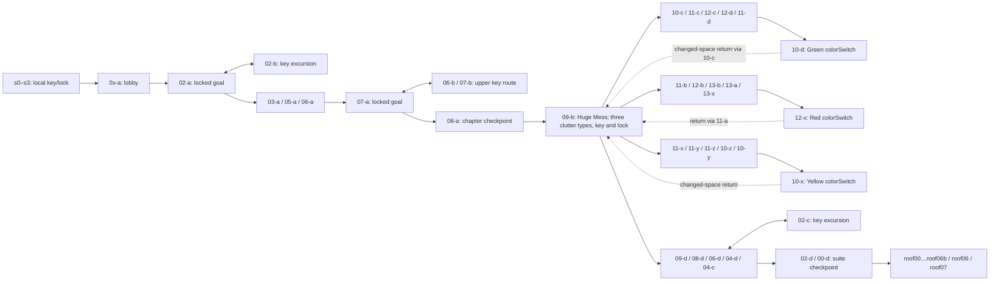

# Celestial Resort: challenge and state analysis

2026-10-08. Current research for the castle-prison challenge revision.
The user explicitly changed the research method to **binary/supporting-data
analysis without physically playing Celeste**. No Celeste playthrough is claimed.
This supersedes the earlier analysis's exclusion of switches and cleanup puzzles.

## Reproducible evidence

Installed source:
`/Users/ari/Library/Application Support/Steam/steamapps/common/Celeste/Celeste.app/Contents/Resources/Content/Maps/3-CelestialResort.bin`.
SHA-256 `8e01509417108d2ec589dce5d198780a9b1614f01ef2504b5ba78bc547a42396`.

- `tools/analyze_celeste_ch3.py`: complete 65-room inventory, dimensions,
  platform widths, gates and 76 static boundary candidates.
- `tools/analyze_resort_challenge.py`: relevant entity attributes and path nodes;
  eight hypothetical colored-clutter removal states per room.
- `tools/render_resort_structure.py`: seven inspected structural schematics.
  Gray is solid tile, muted red/green/yellow is clutter, pink is hazard/path,
  cream is support, gold is an interaction/gate, mint is dash refill, white is
  spawn. These are analytical drawings, not copied game artwork.
- Current outputs: `output/prison_challenge/reference/`.

Map facts below are measured. Entity names suggest behavior but do not prove
runtime collision, speed in seconds, persistence or a legal ordering of cleanup.
Path-node endpoints are not full motion traces. Sequences below are **candidate
route readings**, not executed input recipes. No-grab feasibility in Celeste is
not established. Hooshang's adaptation must be proved with its actual controller.

## Graph and gating

The full 65-node graph and gate coordinates remain in
`celeste_ch3_analysis.md` and the freshly regenerated `map_evidence.json`.
Those links are boundary candidates, not necessarily traversable in both
 directions. This condensed graph emphasizes the challenge-bearing structure:

This is inferred progression, conditional on gates; it does not prove every
cleanup order. Optional networks branch from early key routes; `12-y` branches
from the yellow loop and `01-c` is the cassette side room. Roof invisible barriers
provide explicit one-way constraints. Key excursions deliberately revisit a
visible locked goal; cleanup loops revisit a familiar hub in a changed state.

The binary has five keys, five lock blocks, three color switches, three clutter
doors in the cleanup hub, and touch-switch gates in four rooms. `08-d` and
`11-x` gates explicitly author `persistent=false`. Chapter checkpoints are
`08-a`, `09-d`, `00-d`; 137 player markers across 65 rooms are not 137 chapter
checkpoints. Exact death/respawn and switch persistence still require runtime
code evidence; do not infer them solely from these marker counts.

## What cleanup actually changes in the map

`09-b` is 80×46 tiles. Its 65 red, 76 green and 86 yellow block entities cover
1,339 distinct 8px cells in total. Hypothetically removing red leaves 921,
green leaves 900, or yellow leaves 857. Removing all three leaves zero clutter
cells, while permanent tile structure remains. The central key is at (320,184),
the lock at (64,24); three colored doors occupy different hub edges.

Clutter also occurs in the challenge rooms. `11-c` has all three types covering
97 cells; removing green leaves 43. `12-d` covers 99, dropping to 15 without
green. `10-z` covers 71, with contributions from all three colors. Thus the map
supports a stronger interpretation than “three buttons open one exit”: the
available surfaces and passages can change across multiple rooms. A removed
surface may have been support as well as obstruction. The eight-mask inventory
is a geometric study, not proof that all eight states occur during legal play.

Transfer: local mechanisms should visibly reorganize a route, and completed
work should shorten the return. Avoid deleting necessary support or making
another key depend on an untested cleanup order. Our four wings remain initially
available; local puzzle states provide depth without a global dependency tangle.

## Representative challenge sequences

### 02-b: retrieval is a movement loop, not a pickup on the exit floor

Measured: key (204,140); short jump-through supports at (152,152), (168,168),
(192,120), widths 16/16/24px; fourteen static spinners, two rotating spinners
and one vertical track spinner. Solid geometry divides upper and lower lanes.

Candidate decisions: enter and identify the key below an upper support → choose
an approach around the solid division → time the moving-hazard lane → use the
small support to change height → pass through the key's lower pocket → find
solid support to reset movement → return toward the locked objective. The map
does not justify a claim that every approach needs grab.

Transfer: show the key early, put its approach on a different elevation from the
entrance, and require a deliberate return move before the safe shortcut.

### 11-c: repeated hazards ask different directional questions

Measured: six track spinners. Four move horizontally along 48–56px node spans
on y=96; two have vertical 64px spans. Speed labels alternate Slow/Normal.
The map divides an upper hazard passage from a lower service passage, with
colored blocks occupying parts of both.

Candidate sequence: observe from entry → cross the first horizontal patrol →
change height past the first vertical patrol → land/reassess → cross the second
horizontal pair → time the second vertical passage → leave on the far platform.
Exact phases and timing are unproved; “paired” here means placement, not
synchronized motion.

Transfer: repeat a known timing idea while changing direction or elevation.
Give each major phase a floor refuge; waiting cannot depend on wall grab.

### 12-d: three hazard phrases around a lethal floor

Measured: seventeen static spinners, six track spinners, trigger spikes and
three clutter colors. Two nearby vertical tracks occupy x=88/104, another pair
x=200/216. At the far right, tracks at x=272/312 have opposite authored endpoint
orientations. Entry support is 24px wide; upper-right support is 40px wide.

Candidate sequence: read first pair → launch across it → clear the first stone
partition → traverse second pair → turn upward at the far end → time the final
vertical passage → land on the upper-right refuge → return through the high lane.
This contains multiple decisions before reaching the next room, not one repeated
jump. Collision clearance and dash/refill choices remain route inferences.

Transfer: a capstone should combine a horizontal crossing, vertical reversal and
final controlled landing. Preserve a short retry and make the return easier.

### 11-x: remote activation followed by a return traverse

Measured: touch switch (264,48), gate (72,144), gate destination (112,144),
seventeen static spinners, three Fast horizontal track spinners. The upper
platform sequence leads away from the gate, while the lower floor is hazardous.

Candidate sequence: preview low exit gate → traverse three raised patrol steps
→ climb in elevation to the distant switch → activate → reassess the changed
lower gate → return along a safe route → descend through the opened passage.
The map does not prove whether activation survives death.

Transfer: put the control away from its output, but show their connection.
The return is a meaningful route choice, not an identical mandatory gauntlet.

### 08-d: four-node circuit with high/low reversals

Measured: four touch switches at (184,32), (120,40), (120,136), (184,136);
five refills; eighteen spinners; high left exit gate with `persistent=false`.
Deep ceiling and floor partitions separate the high and low interaction points.

Candidate sequence from the right spawn: enter the right low pocket → touch its
low node → reverse upward via refill space → reach its upper node → move around
the ceiling division → reach the other upper node → descend into its low pocket
→ reverse upward again → traverse to the high exit once the circuit is complete.
This is a plausible order, not a claimed minimum or executed solution.

Transfer: movement must visit several distinct positions and reverse direction.
Hooshang substitutes visible landing/refill opportunities on solid shelves for
Celeste's airborne refill chain. Circuit nodes are touch-activated; no new skill
or wall-hold state is needed.

### 10-z: changing support plus orbiting hazard

Measured: four sinking platforms, each only 16px wide, paired spatially with
four rotating spinners. Two pairs are at y=152, two at y=64. All three clutter
colors occur; a wall spike strip constrains the right side.

Candidate sequence: choose a launch window → reach temporary support → leave
before support movement ruins alignment → clear the orbiting hazard → change
height → repeat in the opposite direction → settle on permanent exit support.
The map alone does not provide sinking speed or orbit period.

Transfer: add a commitment surface only after teaching it. Put permanent ground
before the next timer; do not combine first exposure with a blind deadline.

## Difficulty, metrics and adaptation rules

The prior extractor measures a typical room around 40×23 tiles, with a two-screen
80×46 hub. These are composition references, not templates. Representative
supports above range 2–5 tiles, while hazard node spans are 4–8 tiles. Their
actual player clearance differs from the child's; copying those gaps would be
unjustified. Hooshang keeps its 40×24 wing rooms and 80×48 hub initially.

Use 3–4 consequential actions for introductions, 5–7 for development, 7–10 for
capstones. An action is a takeoff/landing choice, direction reversal, timed
crossing or mechanism decision—not walking an extra tile. These are **our design
targets**, informed by the sequences above, not measured Celeste input counts.
Calibrate required inputs, time between safe rests and recovery in Hooshang.

Main lessons: reveal the goal before the detour; let mechanism state change the
route visibly; develop hazards through direction/height changes; use genuine
multi-position circuits; and bank completed work before demanding another phrase.
Keep the no-climb adaptation explicit in every room. Human difficulty parity
cannot be established from binary counts; final feel remains for user playtest.
