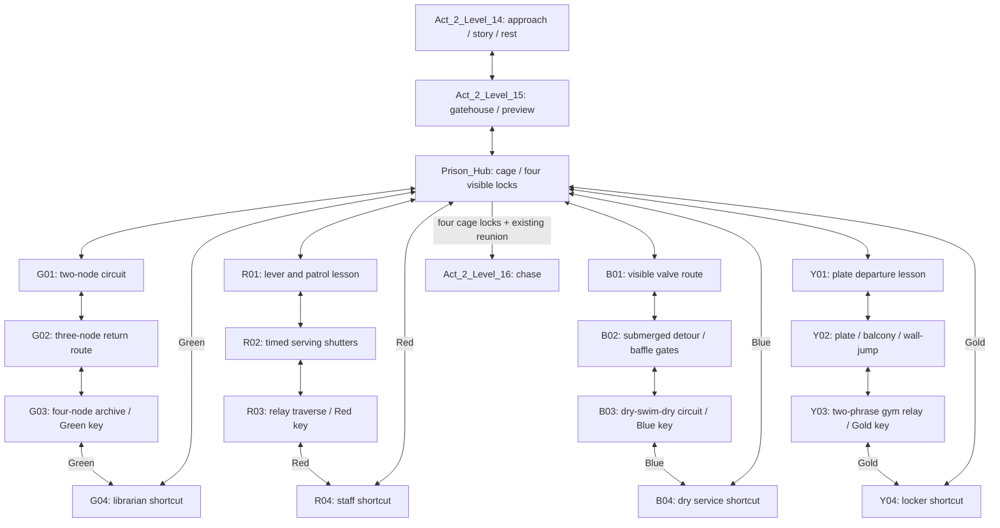

# Castle-school prison: challenge revision

2026-10-08. Design before implementation. Reference:
`celeste_ch3_challenge_analysis.md`. This supersedes the old prison draft's
prohibition on mechanisms. User authorizes pressure plates, levers, switches,
timed doors and other appropriate entities. No player-physics or Act1 edits.

## Scope and structure

Keep the finished garden → castle approach → gatehouse → central cage → four
key wings → rescue → friendly chase → authored ending. Preserve the supplied
Desktop dialogue. The castle is the fortified school compound, not a separate
story destination. Preserve successful entrance/return landings, readable scaffold
art, library furniture, water-bank recovery and the existing short key returns.

All four wings remain reachable immediately. Mechanisms are local to a room or
wing; no previous key is required to begin another wing. This retains the
recognizable Huge Mess excursion structure while avoiding cleanup orders that
remove another route's support. Recommended order is Green, Red, Blue, Gold:
spatial circuits → timed execution → swim/route planning → combined movement.
Players may leave a difficult wing without losing completed rooms or keys.

World positions and external aperture pairs initially stay unchanged. Wing
rooms remain 40×24 tiles; hub 80×48. The castle approach is 80×30 and gatehouse
60×30. All use 8px grid at the existing 320×180 viewport. If a capstone needs
more space, revise its adjacency and design here before expanding the source.

Edges are intended traversable connections; local puzzle gates occupy interior
lanes, not the return portals. Returning to a prior room must always be possible.
Key shortcuts stay locked from both ends until their key is earned.

## Mechanism contract

Use reusable prefabs, typed LDtk fields and explicit entity references. A visible
wire/ornamental conduit and matching symbol connect each control to its gate.
Do not rely on color alone. Every node/gate must be visible from a nearby safe
viewpoint; gates preview incomplete node count and timer state unobtrusively.

- **Touch circuit:** two to four touch nodes; all must be visited to open the
  linked gate. Contact is sufficient; no interaction key during a jump. Order
  is unrestricted, but room geometry gives the intended sequence. Partial
  progress resets on death or room exit. Fully completed circuits latch and
  survive death, room changes and save/load. Lit nodes and a clear gate motion
  acknowledge completion. No extra inventory item is created.
- **Timed lever:** use Up from supported floor to open a shutter for an authored
  interval. An edge press prevents continuous held-Up retriggering. A relay on
  the far safe landing permanently latches that room's passage when reached.
  Before that relay, expiry resets the attempt; the approach lever remains
  reachable without dying. Initial targets 8–12 seconds, calibrated from real
  input traces with at least 25% headroom over a clean ordinary solution.
- **Pressure plate:** player standing on the plate holds the linked shutter
  open. Leaving starts a visible grace timer; return contact resets it. The
  far relay banks success. No pushable crate required for the first revision:
  pressure plus departure timing serves the gym's movement idea directly.
  Initial grace 5–8 seconds; tune from actual child inputs, not Celeste speeds.
- **Valve:** persistent, one-way activation from a dry reachable perch or a
  clearly marked underwater touch target. Opens its linked baffle gate; never
  drains/removes a route's supporting water or closes another player's path.
  The resulting physical shortcut gives the changed-space cleanup experience.
  No oxygen limit and no underwater dash requirement.
- **Gate safety:** authored fully on the 8px grid. A closing shutter must never
  crush, clip, depenetrate or pin the player. If their full body overlaps the
  close volume, defer closure until clear. Both sides lead to safe ground or
  recoverable water; a local return opening or reverse plate avoids trapping.
  Completed gates stay open. Restarting an incomplete room resets transient
  controls before the safe room-entry spawn is restored.

Puzzle persistence belongs to the Act2 prison world alongside its existing
key state, keyed by stable LDtk puzzle IDs. Save only completed circuits/relays
and activated valves; never serialize live countdowns or half-lit circuits.
A missing mechanism field means unsolved unless the legacy-save migration
proves the player had already passed that newly gated room or earned its wing
key. Current-revision saves never infer completion. Keys and dialogue are
preserved. Validate references and reject duplicate/unknown IDs at import.
No cross-act autoload or shared-player changes are needed.

## Room purposes and challenge sequences

Counts are design targets for distinct decisions/actions, not a substitute for
playtesting. Target 3–4 actions to teach, 5–7 to develop, 7–10 to combine. Each
entry includes a supported checkpoint outside mechanism/hazard sweep volumes.

### Castle and hub

- **Act_2_Level_14 (80×30):** retain the broad approach, graffiti/arrest scene,
  staircase, water recovery and rewards. Breather after garden capstone. No new
  mandatory timer during dialogue. Connections: garden13 ↔ gatehouse15.
- **Act_2_Level_15 (60×30):** retain gatehouse route and upper reward. Introduce
  the prison's visual circuit language through an inert diagram/sign beside the
  door; actual controls are taught in wings. Connections: approach14 ↔ hub.
- **Prison_Hub (80×48):** preserve cage, visible four-lock goal and safe wing
  circulation. Show wing symbols, mechanism types and recommended difficulty.
  Completed wing indicators visibly change without removing floor support.
  No mandatory precision or timer. Connections: gatehouse; all four entrances;
  keyed return rooms; existing post-rescue courtyard/chase.

### Green library — representative prototype wing

- **Prison_G01 (40×24):** teach two-node circuit. Preview closed upper passage
  and two lamps → jump to low node → cross to raised node → return to the now
  open passage. 3–4 actions, initially forgiving recovery floor. Keep at least
  one stable spot with both the gate and node feedback visible. Hub ↔ G02.
- **Prison_G02 (40×24):** develop a remote-switch return loop through stacks.
  Ascend two scaffold steps → touch high-left node → dash to opposite gallery
  past a visible stationary hazard band → drop through a controlled opening to
  low-right node → reverse through a second lane to third node → take the
  newly opened upper connection. 5–7 actions; permanent refuge between the
  first dash and reversal. Preserve readable bookcases clear of route silhouettes.
  G01 ↔ G03; retain the revised upper shared aperture.
- **Prison_G03 (40×24):** capstone four-node circuit with high/low reversals.
  Preview key cage → descend to first node → short wall-jump pair onto central
  refuge → cross a patrolling hazard to second node → dash to third upper node
  → descend into opposite pocket → touch fourth node → return along the newly
  opened shelf to key → use shortcut. 7–10 actions in two readable phrases;
  no wall hold and no airborne refill item. A completed circuit stays solved
  even if the final key approach is missed. G02 ↔ G04 (Green gate).
- **Prison_G04 (40×24):** preserve librarian return stair, quiet visual payoff
  and safe bidirectional shortcut. No mechanism reset or new hazard after the
  reward. G03 ↔ Hub, both mouths require Green.

### Red cafeteria — timing and committed traversal

- **Prison_R01 (40×24):** from safe ground, inspect one patrol and the shutter
  it crosses → activate lever → wait for the patrol's departure → jump across
  → touch far relay. 3–4 actions. First miss lands in a recoverable lower lane.
  Hub ↔ R02.
- **Prison_R02 (40×24):** serving-counter loop: activate lever → cross first
  shutter → jump to counter → pass alternating horizontal/vertical patrols
  → dash through second opening → reach relay. 5–7 actions. Show the whole
  timed phrase before launch; resetting requires a short safe walk, not death.
  R01 ↔ R03.
- **Prison_R03 (40×24):** observe two phases before activation → launch from
  first lever → cross a crumbling service shelf → land on permanent midpoint
  → activate second lever → wall-jump to higher lane → dash beneath patrol
  → latch relay → collect Red key. 7–10 actions. Midpoint bank prevents replaying
  the first timed phrase after success. R02 ↔ R04 (Red gate).
- **Prison_R04 (40×24):** preserve staff passage, safe return and readable
  kitchen dressing. R03 ↔ Hub, Red at both mouths. No timed return gate.

### Blue basement — swim navigation and changed routes

- **Prison_B01 (40×24):** preview baffle and submerged control → swim down
  beneath a shelf → touch control → swim through opened baffle → leave on a
  shallow step. 3–4 actions, no hazard at the first interaction. Hub ↔ B02.
- **Prison_B02 (40×24):** descend into lower lane → follow a clearly visible
  current-free hazard corridor → rise into a dry pocket → activate valve to
  open the return baffle → re-enter water → cross the newly opened middle lane
  → exit onto a dry shelf. 5–7 actions, supported bank exits and no blind dive.
  Permanent water never vanishes; activated valve survives death. B01 ↔ B03.
- **Prison_B03 (40×24):** open first dry control → jump into flooded shaft
  → swim around offset hazard baffles → touch remote underwater node → surface
  on a rest shelf → jump/dash to high dry node → descend through opened gate
  → swim to key bank → collect Blue. 7–10 actions. The circuit uses dry and wet
  control, not underwater dash or grab. B02 ↔ B04 (Blue gate).
- **Prison_B04 (40×24):** preserve dry service stair and quick return, with a
  clear water-to-dry change of mood. B03 ↔ Hub, Blue at both mouths.

### Gold gym — plate release, wall jumps and combined sequence

- **Prison_Y01 (40×24):** stand on plate and see shutter open → leave via short
  wall-jump ascent through the opposed faces → descend across the scaffold
  → cross during the eight-second release grace → touch relay. The rendered
  input route takes 6.13 seconds from leaving the plate to checking completion.
  Holding the plate refreshes the timer; the far-side Up lever opens only a
  return attempt and cannot bank success. Wide safe floor
  lets expiry demonstrate itself without a forced death. Hub ↔ Y02.
- **Prison_Y02 (40×24):** stand on the entrance plate → run/jump/dash
  across the preserved 64px balcony gap → brake on the middle bank and regain
  dash → jump/dash the second 40px gap → touch the far seal. Both shutters
  share an 8.5-second release countdown. Middle and far-bank Up levers permit
  retreat but cannot bank success; the downward exit requires the seal.
  This develops Y01 with landing control and two linked crossings, preserving
  the successful balcony rather than repeating its wall-jump lesson. The first
  pit remains readable from the plate; the second gap has the closed exit
  shutter below it as recovery footing. Y01 ↔ Y03.
- **Prison_Y03 (40×24):** two independently banked sequences, both required
  to open the Gold key pocket. The balcony entrance reaches the right side:
  right plate → scaffold ascent → leftward jump/dash through a patrol crossing
  → upper seal (six-second release window). Descend to the left floor plate
  → opposed wall jumps → pass the ascent shutter → midpoint seal (seven-second
  window). Return over the now-open upper route and descend into the key pocket.
  Practice spawn/retries can reach the ascent sequence first; both orders are
  supported and tested. Each sequence has a far-side return lever that opens
  retreat without granting completion. Completed seals survive death; the key
  roof has one permanent shutter per seal. Measured input routes take roughly
  2.5–2.7 seconds for the upper crossing and 4.2 for the wall-jump ascent, leaving
  time to observe and recover. 8–12 deliberate movement actions across the pair.
  The key-pocket exit leaves full-body clearance at the left room transition.
  Y02 ↔ Y04 (Gold gate).
- **Prison_Y04 (40×24):** preserve lockers and quiet return, visibly reconnect
  to the hub. Y03 ↔ Hub, Gold at both mouths.

## Geometry and pacing limits

Use real child momentum and existing hitbox. Initial landing widths: 24–40px,
with 32px or more at observation, interaction and reset spots. Keep ordinary
required rises around 16–24px until live measurement justifies more. Wider gaps
must earn their difficulty through an explicit dash setup and clear landing.
Never require squeezing into an 8px slot, ceiling clipping, land mantle or wall
hold. Use the existing scaffold silhouette for one-way supports. Exact puzzle
coordinates belong in LDtk and the generated validation manifest after layout.

A capstone is not “walk, jump once, collect key.” It must combine at least three
previously taught movement/interaction ideas and include a directional reversal.
Do not meet an action quota with repeated empty jumps. Early rooms remain short;
capstones split at meaningful permanent rests or a completed relay. Safe return
rooms and the hub provide the breathing room after each key.

## Milestones and acceptance

1. Build Green G01–G04 first, including its hub entry, key and return. Validate
   complete input-only loop, all nodes/gates, deaths at every puzzle stage,
   transient resets, completed-circuit persistence, save/load, reverse travel,
   and exit clearance. Capture introduction, capstone and changed return route.
   Do not modify the remaining wings before this complete wing is playable.
2. Apply the standard to Red, Blue and Gold. Give each an authored input recipe
   that demonstrates the stated sequence; test deliberate misses and timeouts.
   Review native renders for clear control-to-gate feedback and landing contrast.
3. Run full prison mission from the castle through rescue and chase transition.
   Verify all 24 key orders at state/connection level, plus several complete
   earned-key movement orders. Test old-save compatibility and current-save
   round trips; all four shortcuts; cage insertion; dialogue skipping.
   Re-run relevant movement, portal, source-sync, save and world-isolation checks.

Audit actual mechanisms, not only IntGrid connectivity. A passing route that
skips the puzzle by walking underneath is a failure of design acceptance.
Tests must prove closed gates prevent bypass while all recovery routes remain
usable. Compare new sequences against the reference patterns; do not call raw
hazard counts proof of Celeste difficulty. Deliver an updated build, milestone
captures and honest scope/limitations. User playtest decides final feel.

## Authored Green wing — 2026-10-09

The library now uses three persistent touch circuits (two, three and four
nodes). Existing room bounds and paired external apertures are preserved.
Coordinates below are local pixels on the 8px authoring grid; node centers may
sit on half-cell positions when an entity has an odd number of cells in width.

- **G01:** nodes at (104,128) and (200,104); a 40×24 gate seals the upper
  aperture. The first scaffold detour teaches contact activation; the second
  node is reached through the right staircase. The heading teaches “touch both
  seals.” The first prototype's gate was cropped by the camera; its lower edge
  now remains visible from the approach.
- **G02:** high nodes at (104,56) and (240,56), then a recessed node at
  (152,176). The authored input route walks beneath the hazard shelf, jumps
  over the floor recess, climbs left, jumps/dashes across the upper gap, reaches
  the right seal, drops into the recess, then climbs back to the newly opened
  right exit. The recessed node deliberately does not sit on the ordinary
  approach. The central spike band stays readable beneath the upper crossing.
  Node order is free; this is the demonstrated route, not a claim that it is
  the only solution.
- **G03:** nodes at (48,128), (144,88), (232,40), and (128,40). Descend to the
  low seal, use the stepped walls to reach the central refuge, jump/dash over
  the patrol lane, climb to the right upper seal, reverse with a dash to the
  left upper seal, then descend along the right shelves through the opened
  gate to the key. A solid roof and the gate enclose the key alcove. A permanent
  scaffold outside the gate makes its approach independent of the shortcut
  door's collision. The central missed-jump pocket is recoverable with wall
  jumps back to the left stairs; the clean route can use ordinary jumps across
  the stepped tops, so a wall jump is a recovery option rather than a forced
  action on every attempt.
- **G04:** geometry and key-controlled doors are unchanged. The key still
  opens both shortcut mouths and persists across deaths. No new puzzle is
  imposed after the key.

All three headings are above the node paths. Sources remain editable in LDtk;
`tools/build_library_challenges.py` is a one-time authoring recipe and refuses
to overwrite already-authored challenge rooms. Geometry revisions were made
against the saved pre-challenge source, preserving every other room.

Validation distinguishes an input-driven traversal from state fixtures. The
route driver now models the full 9×12 player body, with an epsilon only at the
non-overlapping rectangle edge; its old 8px clearance approximation was too narrow. The reverse-travel
trace also exposed arrival tolerance: stopping a few pixels short of a planned
landing changed the next jump into a spike clip. The demonstrated return uses
the spacious right-hand stairs with explicit landings. This correction changes the test
planner, not player physics or collision geometry.

## Authored cafeteria introduction — 2026-10-09

R01 keeps its original patrol and central floor recess. A wall at x=80–88
joins the ceiling to a 32px-high timed passage. The main lever at (264,152)
opens the passage; the completion seal at (64,152) banks it permanently.
PlayerSpawn is now (288,154), on the hub-facing approach. Room bounds and
external aperture pairs are unchanged.

The clean input route activates the lever, approaches the patrol from the
right, waits for a clear phase, jumps the recess, crosses the gate and touches
the seal before leaving for R02. An initial 8-second trial reached the seal in
6.58 seconds. The authored duration is 9 seconds, allowing more than 25% above
that observed attempt; a subsequent phase yielded a 5.08-second completion.
These are measured input runs, not a claim that every player will match them.

**Return lever rule:** each timed gate has a far-side lever with `CanBank=false`.
It opens the same passage so a player who crossed as the timer expired can
retreat safely. It cannot activate the completion seal. The arrow above it
points toward the gate. Returning to the main lever and pressing Up again
starts a bankable attempt. Holding Up never continuously refreshes the timer;
activation requires a fresh press while standing on floor.

A shutter that was open defers closure while the full player body overlaps it.
An initially closed shutter cannot be opened by overlap. Deferred collision
closure does not extend the completion deadline. Partial timers reset on death
or room exit; completed relays persist under stable `PuzzleId` values in the
Act2 save. Legacy-save migration preserves access behind newly added barriers;
otherwise missing timer state starts unsolved and retains keys.

New LDtk entities are `TimedGate` (PuzzleId, Duration), `TimedLever` (Gate entity
reference, CanBank), and `TimedRelay` (Gate reference). Validation requires a
unique puzzle identity, same-room references, a main lever, a return lever and
one completion seal. R02 now uses linked shutters sharing one controller, as
documented below. R03 still requires two separately banked phrases; neither
remaining room is built by the introductory-room script.

## Authored serving-counter room — 2026-10-09

R02 now develops the lever with two linked shutters and a banked exit. The main
lever at (288,152) starts a 12-second timer. Cross the first shutter at (244,144),
observe the vertical patrol from the lower safe floor, jump via the scaffold at
(200,144) to the counter at y=120, then dash left through the raised shutter at
(124,104). Touch the seal at (64,128); only then does the 40px-wide bottom exit
open. This prevents leaving the room before completing its encounter.

`TimedShutter` carries a same-room `Gate` reference and `RequireBank` boolean.
Ordinary shutters share the controller's timer; a banked-only shutter ignores
live countdowns. Each panel independently defers closure while occupied.
Return-only levers at (40,152) and (208,152) reopen the timed route but cannot
bank the seal or open the final exit. The lower floor is continuous on the
approach side, and the raised counter has a recoverable jump from both sides.

Three rendered input runs completed in 6.85, 5.83 and 8.00 seconds with different
patrol phases, no deaths, and no climb/mantle. The runtime and authored geometry
remain unchanged between those runs. These demonstrate feasibility; the user's
playtest will determine whether the observation margin and difficulty feel right.

## Save compatibility for newly added gates

`prison_save_migration.gd` owns a prison-only `puzzle_revision` (currently 5).
For saves predating a puzzle, a matching saved room-entry checkpoint beyond
that puzzle completes only the earlier rooms in that wing. An already-collected
wing key completes that wing's newly introduced puzzles. The current room's
puzzle remains unsolved unless its key was already earned. The migration never
uses a debug/practice room selection as proof of progress.

Only registered gate IDs become saved completion; keys, inserted locks and
story state are untouched. Current-revision saves retain their exact recorded
completion state, including interrupted attempts. Future newly gated rooms must
get a later introduction revision, and REVISION must advance with them. This
preserves older checkpoints without granting later puzzles to every fresh run.

## Authored pantry capstone — 2026-10-09

R03 has two independent banked phrases, followed by a key alcove requiring both.
The first lever at (40,152) starts six seconds: jump to the low scaffold, cross
the crumbling service shelf at (108,140), jump/dash through the first shutter,
and touch the midpoint seal at (168,112). The permanent midpoint floor extends
from x=160 to216 at y=120. Its return lever restores the shelf as well as opening
the first passage. A missed shelf jump lands on the lower floor, with an ordinary
jump back to the left approach; it does not force death.

The second lever at (200,112) starts 4.5 seconds: jump to the launch scaffold,
observe the vertical patrol from that safe position, dash under it during its
high phase, and reach the seal at (280,104). The far landing extends clear of
the patrol, with a return control at (288,104). Drop around the end of that
landing, use the right step, and reverse into the key alcove. Two adjacent
banked-only shutters cover the alcove; completing either phrase alone cannot
expose the key. The step also supports return travel after collecting it.

The first prototype's patrol never entered the dash lane. Its final center is
(260,80), amplitude16, so a low phase really is lethal. The far seal was also
moved out of its sweep after a rendered run caught a death during the landing.
The initial nine-second timers were reduced after measuring the movement
phrases. These corrections make observation and timing meaningful; difficulty
is still subject to the user's playtest.

`CrumblingShelf` is an LDtk entity with a same-room Gate reference. It reuses
existing crumble physics and the prison's scaffold art, including warning
motion and a visible spent outline. A linked lever restores it even after its
phrase is permanently completed; death and room re-entry restore it too. Its
LDtk preview uses the same scaffold tile. No shared player/platform physics or
Act1 assets were changed. Save migration revision2 introduces only the two new
pantry controllers, preserving earlier completed state and legacy Red keys.

## Authored basement introduction — 2026-10-09

B01 teaches a permanent submerged control. The touch seal at (104,160) opens
the sluice at (204,176), which seals the bottom aperture to B02. A solid baffle
at x=136–152 extends from the waterline to y=144, encouraging a dive beneath it.
The sluice's side walls start at y=168, leaving 24px of height below the baffle
for the swim across. Earlier walls left a cramped turn and sent the navigation
route above the baffle; the final underwater passage is direct and readable.

The authored input sequence is dive to seal → swim beneath baffle → approach
sluice → swim down to B02. Reverse travel swims back through the opened sluice
and around the baffle to the entrance bank. No water disappears and there is no
timer or hazard in this introductory interaction. External apertures, existing
stairs and bank geometry remain intact.

`FloodGate` uses the existing persistent circuit ledger with exactly one
`FloodValve`. The valve carries same-room `Gate`, `Touch` and `RequireDry`
fields: B01 uses contact activation underwater; later rooms can require a fresh
Up press from dry footing. These two activation modes reuse the established
seal and lever artwork. A solved sluice stays open through death, room re-entry
and save/load. Migration revision3 preserves older Blue-key access. The two
remaining Blue challenge rooms still need authoring; this is only the lesson.

## Authored flooded stores — 2026-10-09

B02 develops the swim lesson with a dry valve pocket. Enter from the upper
scaffold at (204,18), descend into the right pool, swim beneath the baffle at
x=160–176, rise through the 32px-wide shaft at x=128–160, and enter the dry
pocket from its right side. The pocket has 32px of headroom, permanent footing
at y=128, a roof across x=80–176, and a left wall ending at y=160. Its roof
prevents dropping directly onto the valve from the upper platform route.

Stand at (104,122) and press Up to operate the control at (104,120). It permanently
opens the left exit sluice, at (4,144). Re-enter the shaft, swim down and left
under the pocket's floor, and rise into the exit lane. The visible deep-water
hazard lies at x=176–200, y=176; it leaves room to observe and steer above it.
A successful activation persists across death and re-entry. Water never changes.

The rendered input route also reverses through B03 back into B02, crosses the
lower passage and returns to the right approach without collecting a key.
The generic navigation graph initially rejected entering the low-roof pocket
because it modeled a land jump arc during the swim-to-dry transition. Explicit
horizontal swimming inputs proved the actual transition works; the player
controller and pocket geometry were not changed to satisfy that graph.

The lever draws behind the child, and its instruction was moved clear of the
background vent. Only B02 geometry and its sign/spawn/entities were authored;
other room data remains unchanged. Migration revision4 preserves older Blue-key
or downstream-checkpoint access through this new sluice.

## Authored pump-room capstone — 2026-10-09

B03 is approached from B02 through its right-hand water passage. The Blue key
remains visible on the upper right bank, but a solid roof, the existing boundary,
and a circuit gate at (276,80) now enclose it. A dry bank at x=240–272, y=96
supports the valve at (256,88); its masonry ends at y=128 so it does not block
the entrance passage below. Default room spawn is (256,90).

Operating that valve permanently opens the submerged sluice at (156,160).
Swim left through it to the deep seal at (104,160), with a visible floor hazard
below. The chamber's roof and sides prevent reaching that seal from above or
walking in from the left. Reverse through the sluice, surface at the dry bank,
reach the launch platform at (232,58), then jump/dash onto the high seal landing
at (184,34). The demonstrated sequence jumps before steering the dash; it does
not need climbing, a wall grab or an underwater dash.

Both contact seals open the key gate. Return along the right platforms, collect
Blue, and use the original left stairs and upper shortcut through B04 to the
hub. The existing B04 geometry and exterior apertures were preserved. Seal order
is free; the dry valve is required to enter the deep chamber. Death resets an
incomplete two-seal circuit but retains the valve. Once both seals are complete,
the gate remains open even if the key approach is missed. Migration revision5
preserves older Blue keys and downstream checkpoints across both new barriers.

The input driver uses explicit waypoints where the general graph's fixed jump
arc cannot model a water exit or a jump through stacked one-way platforms.
These are test-route corrections, not controller changes. Its first shortcut
check also treated an already-completed room transition as a missing portal;
removing that redundant approach step confirmed the actual connection works.

## Final Gold wing and visual language

These authored details supersede the initial Gold sketches above.

Y01 introduces a pressure plate at (96,156). Occupation holds the shutter open;
leaving starts eight seconds. Wall-jump through the existing scaffold sequence,
cross the shutter at (268,136), and touch the seal at (288,152). The far return
lever opens retreat without banking success. The observed successful crossing
takes 6.13 seconds; the test also holds the plate for nine seconds and deliberately
lets an attempt expire before retrying.

Y02 develops the idea into two gaps (64px and 40px) under one 8.5-second timer.
The plate is at (48,156). Land on the middle bank to restore dash, clear the
second gap and touch the far seal at (288,152). The bottom exit at (252,180)
opens only after completion. Middle and far return levers provide retreat without
solving the puzzle. A missed deadline on the middle bank remains recoverable:
drop onto the closed exit floor, jump back to the bank, reopen retreat, return
to the start and try again. The rendered retry route verifies that sequence.

Y03 combines two independently banked phrases. The right plate at (256,116)
starts six seconds for the upper reverse-direction jump/dash to (104,56), past
the moving patrol. The left plate at (112,156) starts seven seconds for the
wall-jump ascent to (232,112). Both seals remove separate roofs over the Gold
key at (64,154); one completed phrase cannot bypass the other. The real balcony
entrance reaches the right phrase first; the room checkpoint can approach the
left first. Either order works. Completed phrases survive death, while interrupted
timers reset. Return levers cannot bank completion. Actual measured crossings
were 2.53 seconds for the upper phrase and 4.17 seconds for the ascent.

Y04 is a quiet shortcut and return route. Key pickup opens the hub connection;
the full wing can also be traversed backward. All four Gold controllers persist
in revision8 saves; migration preserves access for pre-challenge Gold-key saves.

The final readability pass removes permanent connection wires and large gate
badges. Small brass controls and seals distinguish interactions from hazards.
Only an active timer draws a short countdown beside its gate. Concise room
headings stay clear of landings and the HUD. One-way platforms are thin warm
wooden lips with transparent undersides; solid crumbling shelves retain steel
scaffolding on a separate atlas tile. These changes preserve collider positions,
mechanism behavior, player physics and Act1 art.
